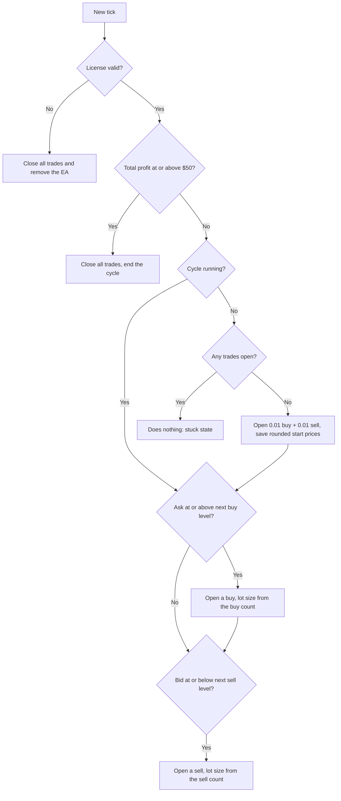

<Warning>
This EA has no stop loss, no drawdown limit and no maximum lot size. Run it only on a demo account until the fixes and protection layers on this page are in place.
</Warning>

## At a glance

| | |
|---|---|
| **File** | `Pending Order V2 Mian.mq5` (internal name `Breakout_Market_Grid.mq5`, version 1.40) |
| **Symbol** | XAUUSD (gold) only. The grid rounds prices to whole dollars. |
| **Account type** | Hedging. It holds buys and sells at the same time. |
| **Order type** | Market orders only, despite "Pending Order" in the name |
| **Strategy** | Two-way breakout pyramid with a flat profit target |
| **Stop loss** | None |

## How it trades

Each cycle works like this:

1. The EA opens a 0.01 buy and a 0.01 sell at the same time.
2. It saves both start prices, rounded to the nearest whole dollar.
3. Every time the price makes a new high $1 above the last buy level, it opens another **buy**.
4. Every time the price makes a new low $1 below the last sell level, it opens another **sell**.
5. Trades never close one by one. When the total profit of all trades reaches **$50**, the EA closes everything and starts a new cycle.

The lot size grows every 3 trades on each side:

| Trade number on a side | 1–3 | 4–6 | 7–9 | 10–12 | 13–15 | ... |
|---|---|---|---|---|---|---|
| Lot size | 0.01 | 0.06 | 0.11 | 0.16 | 0.21 | keeps growing, no limit |

## Settings

| Input | Default | What it does |
|---|---|---|
| `InpStartLot` | 0.01 | Lot size of the first trades on each side |
| `InpLotIncrement` | 0.05 | Added to the lot size every `InpStepTrades` trades |
| `InpStepTrades` | 3 | Number of trades before the lot size steps up |
| `InpGridGap` | 1 | Price distance between new trades, in dollars. The code comment suggests $1.30 for gold. |
| `InpTargetProfit` | 50.0 | Closes all trades when total profit, including swap and commission, reaches this amount |
| `InpMagicNumber` | 123456 | Identifies this EA's trades |

Settings compiled into the code, which users can't change:

- **Allowed account:** one hardcoded account number.
- **Expiry date:** 28 October 2099 in this copy, so it effectively never expires.
- **Maximum slippage:** 50 points ($0.50).

This version has **no** spread filter, **no** stop loss and **no** percentage target. A target of "1% of equity" is just $50 on a $5,000 account.

## License system

- The EA checks the account number and expiry date when it starts and again on every tick.
- On the wrong account or after expiry, it **closes all trades at market and removes itself**, even if those trades are at a large loss.
- The account number and date are hardcoded, so the seller must recompile the EA for every client. There is no online control.

## Where the profit and the risk come from

A clean one-way move of about $6.50 from the start price reaches the $50 target. Gold makes moves like that many times a day, so most cycles win quickly.

The danger is a move that goes partly one way, reverses and comes back. Both pyramids get built and both lose while the price sits in the middle. The wider the range, the bigger the loss, because the lot size keeps stepping up.

These results come from a simulation of the EA's exact rules with default settings, a 0.01 start lot and a $0.08 spread:

| Gold's path from the start price | Result | Open lots | Profit or loss |
|---|---|---|---|
| Straight up about $6.50 | Closes at target | 0.33 | +$50 |
| Up $5, then down $15 | Dips to -$150, then closes at target | 1.23 | +$50 |
| Up $5, down to -$10, back to start | Still open | 1.07 | -$689 |
| Up $5, down to -$10, up to +$10, back to start | Still open | 1.72 | -$1,227 |
| Up $5, -$10, +$10, -$15, back to start | Still open | 2.77 | -$2,616 |

A Monte Carlo test ran 4,000 cycles on a random-walk gold price with a $0.08 spread:

| Loss that ends the account | Cycles that win $50 | Cycles that hit the loss first |
|---|---|---|
| $1,000 | 94.2% | 1 in 17 |
| $2,500 | 97.7% | 1 in 44 |
| $5,000 | 98.9% | 1 in 87 |

Some winning cycles dipped almost as low as the account-ending loss before they recovered. The average result per cycle was negative, because every entry pays the spread.

Real gold trends more than a random walk, which helps this EA for a while. The shape stays the same: many small wins and rare, very large losses. The balance curve only records the closed +$50 wins, so balance drawdown looks tiny. The real risk is **equity drawdown**, the loss on trades that are still open.

## Bugs and weak points

| Problem | What happens | Fix |
|---|---|---|
| No stop loss or limits | Losses grow until the broker's margin stop-out closes the trades | Equity stop, maximum levels and maximum total lots |
| Lot size has no cap | Each new level adds more risk than the last | Cap the lot size or use a flat lot size |
| Half-open start | If the buy fills but the sell fails, the EA stops managing and holds one trade with no stop | Check each order's result, then complete the hedge or close the trade |
| Restart loses the cycle | Cycle state lives only in memory. A VPS reboot, terminal restart or settings change leaves open trades unmanaged | Rebuild state from open trades, or save it in terminal global variables |
| Orders stack on price jumps | After a fast jump, it opens one trade per tick at the same price until the count catches up. A $6 spike can stack 6 trades and 0.33 lots at the top | Open trades by level number, one trade per level |
| No spread filter | A spread spike at rollover or on news can trigger fake entries | Add a maximum-spread input and trigger on the mid price |
| Close-all doesn't check results | If any close fails, the EA resets anyway and leaves those trades unmanaged | Retry until every trade is closed, then reset |
| Fixed $50 target | The same target applies to a $1,000 and a $100,000 account | Set the target as a percentage of equity |
| Expiry closes at any loss | On the expiry date, every trade closes at market, whatever its loss | At expiry, stop new cycles, send an alert and let the current cycle finish |
| Start levels rounded | The first new trade can open $0.50–$1.50 away instead of $1 | Use the exact entry prices |
| Order success not checked | `trade.Buy()` returning `true` doesn't mean the order filled | Check `trade.ResultRetcode()` for `TRADE_RETCODE_DONE` |
| No account or symbol check | On a netting account, the buy and sell cancel out. On other symbols, the rounding breaks the grid | Check `ACCOUNT_MARGIN_MODE` and the symbol in `OnInit` |

Minor issues: `#property strict` is a leftover from MQL4, and the comments call the close-all function "async" although it runs synchronously.

## Upgrade plan

<Steps>
  <Step title="Fix the bugs">
    Check every order result, recover state after a restart, place one trade per level, retry closes until all trades are closed, and check the account type and symbol at startup.
  </Step>
  <Step title="Add protection layers">
    Add a per-cycle equity stop (for example, close everything at 2–3% loss), maximum levels per side, maximum total lots, a daily loss limit, a drawdown kill switch, margin checks, a spread filter, a news pause and weekend closing.
  </Step>
  <Step title="Make it smarter">
    Set the target as a percentage of equity with a trailing basket profit. Base the grid gap on ATR. Detect choppy markets and shrink exposure when both sides are built. Start cycles only in sessions where breakouts are likely. Add a chart dashboard, Telegram alerts and an online license.
  </Step>
  <Step title="Test it properly">
    Backtest with real ticks from 2020 to 2026 and record the maximum equity drawdown. Stress-test with wider spreads and execution delays, then forward-test on demo accounts with different broker conditions.
  </Step>
</Steps>
